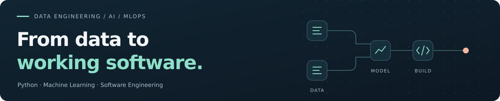
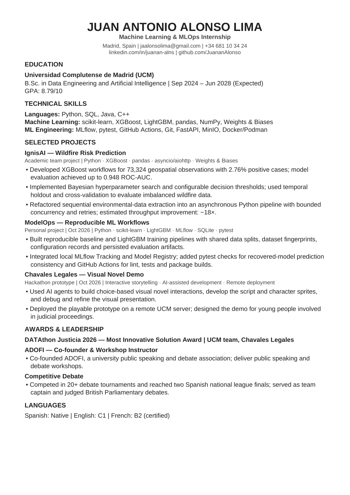

  

# Juan Antonio Alonso Lima

**Data Engineering & Artificial Intelligence student · UCM · Madrid**

I build data pipelines, reproducible ML workflows and applications. My interests sit at the intersection of **software engineering, machine learning and MLOps**.

  
  
  

[View CV on GitHub](./Juan_Antonio_Alonso_Lima_ML_MLOps.pdf) · [Selected projects](#selected-projects) · [Beyond engineering](#beyond-engineering)

## Open source contributions

[**1 merged pull request**](https://github.com/pulls?q=is%3Apr%20is%3Amerged%20author%3AJuananAlonso%20is%3Apublic%20-user%3AJuananAlonso) in external open source projects.

Contributed to [dataprof](https://github.com/AndreaBozzo/dataprof) by [restricting release workflow permissions and disabling persisted checkout credentials](https://github.com/AndreaBozzo/dataprof/pull/1217).

## Selected projects

### [ModelOps ↗](https://github.com/JuananAlonso/ModelOps)

**Reproducible ML workflows** · Personal project, in development

Built baseline and LightGBM training pipelines with shared data splits, dataset fingerprints and saved evaluation artifacts. Integrated local MLflow Tracking and Model Registry, with automated checks for recovered-model prediction consistency and CI for lint, tests and package builds.

`Python` `scikit-learn` `LightGBM` `MLflow` `pytest` `GitHub Actions`

### [IgnisAI ↗](https://github.com/UCM-GIDIA-PD1/c2526-R3)

**Wildfire risk prediction** · Academic team project

Refactored environmental-data extraction into an asynchronous Python pipeline with bounded concurrency and retries. Developed XGBoost experiment workflows with Bayesian hyperparameter search in Weights & Biases for imbalanced wildfire data.

`Python` `asyncio` `aiohttp` `XGBoost` `Weights & Biases`

### [Chavales Legales ↗](https://github.com/lucasosp/ChavalesLegales-TeamUCM)

**Interactive storytelling for legal education** · Hackathon team prototype

Helped build and deploy a choice-based visual novel for young people involved in judicial proceedings, using AI-assisted development for interactions, story and visual assets. Our UCM team won the **Most Innovative Solution Award at DATAthon Justicia 2026**.

`Interactive storytelling` `AI-assisted development` `Remote deployment`

### [GymFlex ↗](https://github.com/UCM-FDI-DISIA/proyectogp-gymflex)

**Workout tracking & social features** · Team project

Implemented workout logging backed by Supabase, including exercise sets, repetitions and weights. Developed direct messaging and user-search flows, and improved duplicate-message handling and draft recovery after failed sends.

`React Native` `Expo` `Supabase`

## Beyond engineering

**Co-founder of ADOFI**, a university public speaking and debate association, where I deliver workshops and organize debates and competitions.

Competed in **20+ debate tournaments** and reached **two Spanish national league finals**; also served as team captain and judged British Parliamentary debates.

**Languages** · Spanish — native · English — C1 · French — B2, certified

## Résumé

My one-page CV focuses on **Machine Learning & MLOps**.

[**Open the PDF ↗**](./Juan_Antonio_Alonso_Lima_ML_MLOps.pdf) · [**Download ↗**](https://raw.githubusercontent.com/JuananAlonso/JuananAlonso/main/Juan_Antonio_Alonso_Lima_ML_MLOps.pdf)

  
Preview my one-page CV

  

    
  

---

[LinkedIn](https://www.linkedin.com/in/juanan-alns/) · [jaalonsolima@gmail.com](mailto:jaalonsolima@gmail.com)
